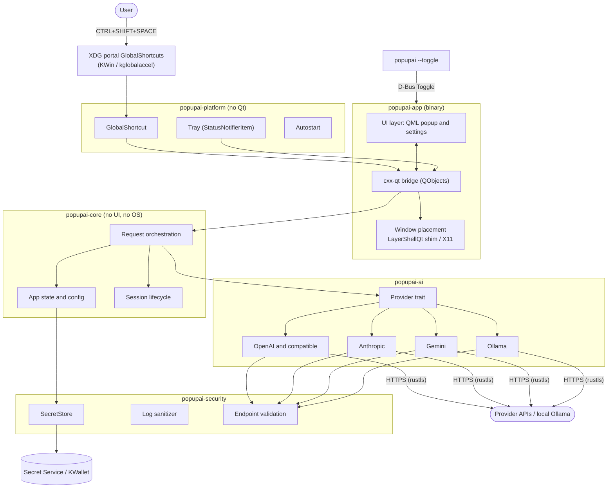

# Architecture

Status: 2026-11-02. The Qt-free crates are implemented (table below); the desktop
and UI layers are not started. Decisions are
recorded in [docs/ADR/](ADR/): [0001 stack](ADR/0001-technology-stack.md),
[0002 Linux integration](ADR/0002-linux-desktop-integration.md),
[0003 session policy](ADR/0003-session-and-cancellation-policy.md).

## Implementation status

| Component | State | Verification |
|---|---|---|
| `popupai-core`: session lifecycle (ADR 0003) | Implemented | 15 unit tests |
| `popupai-security`: `Secret`, `Endpoint` validation, log redaction, `SecretStore` trait | Implemented | 20 unit tests |
| `popupai-platform`: OS secret store backend (Secret Service: KDE Wallet, GNOME Keyring, KeePassXC) | Implemented; fails closed when no service runs | 4 unit tests, plus a private-bus test showing every operation fails closed. The **round trip against the real wallet is an ignored test, not yet run** |
| `popupai-core`: Markdown renderer (whitelisted tags, no attribute, no image, no link) | Implemented | 12 unit tests, including hostile inputs and half-finished streams |
| `popupai-core`: lightest default model per provider, Ollama smallest-installed model | Implemented | Unit tests and end-to-end tests against the scripted server. The vendor model names come from their documentation and are **not verified by a live call** |
| `popupai-ai`: OpenAI, OpenAI-compatible, Anthropic, Gemini, Ollama adapters, streaming, cancellation, error taxonomy | Implemented | 39 unit tests and 17 end-to-end tests against a scripted local server |
| `popupai-ai` against the live services | **Partly verified** | Real services, 2026-11-02: a local Ollama answers end to end; Anthropic, OpenAI and Google each rejected an invalid key with an authentication error (endpoints and headers confirmed; Google's HTTP 400 for a wrong key found and fixed). **Not verified:** a request with a valid key and the hosted services' streamed answers, which need the user's own key |
| `popupai-core`: configuration (validation, atomic `0600` storage, no keys in the file) | Implemented | 13 unit tests |
| `popupai-core`: API keys bound to their endpoint, user-facing error messages | Implemented | 8 and 5 unit tests |
| `popupai-core`: request orchestrator (single in-flight request, cancellation, connection reuse, metadata-only logs) | Implemented | 13 unit tests with a scripted provider, plus a log-privacy test in its own binary |
| Orchestrator with the real adapters | **Not verified** | Tested with a scripted provider; the adapters are tested separately against a local server |
| `popupai-app`: model picker (Ctrl+P), adaptive width; its list logic has 4 unit tests; **layout and keyboard use not yet seen on screen** |
| `popupai-app`: minimal QML popup, cxx-qt controller, view model, key entry, provider switching | Implemented and resident | Logic: unit tests; 22 headless checks on a private bus (single instance, toggle, fresh sessions, quit, graceful absence of portal, tray and wallet). On screen: the earlier layout was observed on 2026-11-02; **the minimal layout and the key field have not been looked at on screen yet** |
| `popupai-platform`: single instance and remote commands (`--toggle`, `--background`, `--quit`) over D-Bus | Implemented. The app is now resident: dismissing hides the window and a later command shows it with a fresh session | 5 tests on a private `dbus-daemon`, plus `tools/smoke-resident.sh` (19 checks, headless, private bus). Not yet tried on screen across several show and hide cycles |
| `popupai-platform`: global shortcut (XDG portal), tray (StatusNotifierItem), autostart (XDG entry) | Implemented and wired into the application | 15 tests of the shortcut client (4 unit, 11 end to end against a **mock portal**), 5 of the tray (4 unit, 1 against a **mock host** run as a child process), 5 of autostart on a temporary folder. On the real session (2026-11-02) the portal registration, the unassigned-key case and the tray registration were observed in logs; the user reported that the shortcut, icon and popup work. The wallet was **not** touched |

## Component diagram



## Layers

| Layer | Crate or location | Responsibility | Depends on Qt? |
|---|---|---|---|
| UI | `popupai-app/qml/` | Input, streaming answer, loading state, provider selector, settings | Yes |
| Desktop (Qt-bound) | `popupai-app/src/window/` | Popup lifecycle, layer-shell or X11 placement, focus and dismissal | Yes |
| Desktop (Qt-free) | `popupai-platform` | Global shortcut, tray, autostart behind traits | No |
| Application core | `popupai-core` | State, session lifecycle, config schema, orchestration | No |
| AI | `popupai-ai` | `Provider` trait, adapters, streaming, cancellation, error taxonomy | No |
| Security | `popupai-security` | `SecretStore`, log sanitizer, endpoint and redirect policy | No |

Platform traits (Linux implements first; Windows and macOS later):
`GlobalShortcut`, `Tray`, `Autostart`, `PopupPlacement`, `SecretStore`. Outside-click
dismissal and focus handling live behind `PopupPlacement`. **No Linux-specific
logic is allowed in core, ai or security.**

## Project structure

```
PopUpAI/
├── Cargo.toml                  # workspace
├── crates/
│   ├── popupai-core/           # state, sessions, config, orchestration
│   ├── popupai-ai/             # Provider trait + openai, anthropic, gemini, ollama
│   ├── popupai-security/       # SecretStore, log sanitizer, endpoint validation
│   ├── popupai-platform/       # traits + linux/ (ashpd, ksni, autostart)
│   └── popupai-app/            # binary: cxx-qt bridge, window/, qml/, --toggle
├── packaging/                  # desktop file, metainfo, icons, rpm spec, flatpak
├── docs/                       # this folder
├── .env.example                # placeholders for opt-in live tests only
└── README.md  SECURITY.md  CONTRIBUTING.md  CHANGELOG.md
```

Five crates, each with a reason to exist: the first three are UI-agnostic and
unit-testable without a desktop; `platform` isolates D-Bus and portals; `app` is
the only crate that links Qt.

## Quick Ask data flow

1. The portal emits `Activated` (or `--toggle` arrives over D-Bus).
2. `app` asks core for a fresh session, then shows the pre-created window with
   the input focused (ADR 0002, ADR 0003).
3. On Enter, core builds a request from the session and the selected provider
   configuration, and fetches the key from `SecretStore` just in time.
4. The adapter streams chunks. Each chunk becomes an event to the UI thread.
   Network and D-Bus work never run on the UI thread.
5. The Markdown block model updates incrementally; the view auto-scrolls.
6. Stop aborts the HTTP request. Dismissal follows ADR 0003.

## Provider contract

Common interface: send messages, stream tokens, cancel, list models (where
supported), and a typed error taxonomy (`Auth`, `RateLimited`, `Network`,
`Timeout`, `InvalidEndpoint`, `Provider`). Adapters are isolated; one failing
provider cannot affect another. OpenAI-compatible endpoints reuse the OpenAI
adapter with a custom base URL. Model identifiers are free text, with discovery
as a convenience (OpenAI-compatible `/models`, Ollama `/api/tags`).

## Security model

**Assets:** API keys, prompts, responses, provider configuration.

| Threat | Control |
|---|---|
| Key stolen from disk, git or backups | Keys only in the OS secret store (Secret Service / KWallet; Credential Manager; Keychain). No plaintext fallback: if the store is unavailable the app says so and refuses to save a key. |
| Key leaked to the wrong host | One HTTP client per provider bound to its origin; redirects not followed for authenticated requests; no credentials in URLs (Gemini uses a header); no cross-provider reuse. |
| Insecure transport | HTTPS required. Plain HTTP only for loopback, or with an explicit per-provider opt-in and a visible warning. URLs containing user-info are rejected. rustls, no "accept invalid certs" option. |
| Secrets or content in logs | Structured `tracing` logs; secrets wrapped in a redacting type; prompts and answers never logged at default levels. |
| Exfiltration through untrusted model output | Markdown is rendered by our own block renderer: no HTML, no automatic remote image loading, links shown with their real target and only opened on explicit click for `http(s)` and `mailto` schemes. |
| Hidden data collection | No telemetry, analytics, clipboard reads or screen capture. Copy buttons only write. |
| Abuse of the local IPC | D-Bus interface limited to `Toggle`, `Show`, `Hide`. |
| Tampered configuration file redirecting a provider to another host | Each key is stored with the origin it was saved for and released only for that origin; changing the endpoint requires saving the key again. The file is written atomically with mode `0600`, and a file writable by group or others is refused. Keys found in the file are rejected without being echoed. |
| Supply chain | Minimal dependencies, committed `Cargo.lock`, `cargo audit` and `cargo deny` in CI, secret scanning (see [SECURITY.md](../SECURITY.md)). |

Configuration lives in `$XDG_CONFIG_HOME/popupai/config.toml`, written atomically
with mode `0600`, and **contains no secrets**.

## Performance budget

The 150 ms activation target applies to local latency only; provider inference
time is reported separately.

| Metric | Target | Status | How it will be measured |
|---|---|---|---|
| Popup activation, warm | < 150 ms from shortcut event to first frame with focused input | First measurement on 2026-11-02 (6 shows, local application only): command to keyboard-ready median 8 ms, min 4 ms; the first show after start 158 ms (cold), the next five 4 to 9 ms. Command to first frame median 3 ms, first show 72 ms. Second and third (unattended) runs: median 6 and 8 ms, first show 114 and 138 ms. These do not include the compositor's own display latency, and the cold first show was above target once and just below it the other time | Monotonic timestamps at shortcut received, `setVisible(true)`, first frame, active, input focus |
| Idle CPU | Close to 0 % | Unmeasured | `/proc/<pid>/stat` over 60 s with the popup hidden |
| Idle memory | Provisional budget < 100 MB PSS, to be revised after the first baseline | Unmeasured | `/proc/<pid>/smaps_rollup` |
| Cold start to ready | Provisional < 1 s | Unmeasured | Process start to shortcut registered |
| Repeated discovery requests | None while idle | By design | Model discovery only on explicit user action or settings open, cached |

Targets marked provisional are not claims; they are budgets to check.

## Platform abstraction summary

See [PLATFORM_COMPATIBILITY.md](PLATFORM_COMPATIBILITY.md) for what is verified
and what is only planned.
